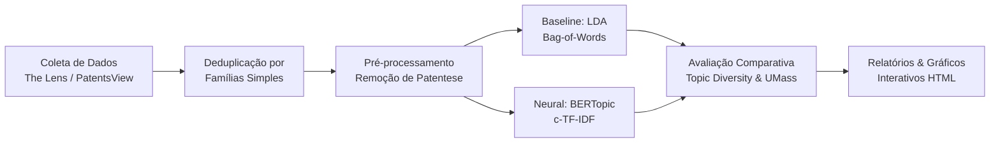

# Pipeline de Mineração Patentária e Modelagem de Tópicos em IA (CPC G06N)

> **Projeto de Conclusão de Curso (TCC)**  
> **Curso:** Curso Superior de Tecnologia em Inteligência Artificial — FATEC Rio Claro  
> **Tema:** Panorama da Propriedade Intelectual em Inteligência Artificial: Uma Abordagem Patentométrica via Mineração de Dados Textuais  
> **Autora:** Elisama Cristine dos Santos  
> **Orientador:** Prof. Dr. Julio Cesar de Lemos  

---

## 📖 Visão Geral

Este repositório contém o pipeline modular e reproduzível de **Descoberta de Conhecimento em Textos de Patentes (KDD)** desenvolvido para o TCC. O objetivo é analisar documentos patentários de Inteligência Artificial indexados sob a subclasse **CPC G06N** (*Computing arrangements based on specific computational models*), cobrindo o período de transição tecnológica entre **2019 e 2026**.

O pipeline compara um modelo **Baseline clássico** (*Latent Dirichlet Allocation* — LDA) com uma abordagem baseada em **Modelagem Neural de Tópicos** (*BERTopic* com *class-based TF-IDF*), avaliando quantitativamente a coerência semântica e a diversidade temática dos clusters obtidos.

---

## 🛠️ Arquitetura do Pipeline



1. **Ingestão e Deduplicação:** Suporte a arquivos exportados da plataforma *The Lens* e consultas via *PatentsView API*. Deduplicação automática por **Famílias Simples de Patentes** (*Simple Patent Families*), eliminando redundâncias de extensões internacionais.
2. **Pré-processamento Especializado:** Higienização de ruídos formais e termos jurídicos padronizados de redação patentária (*patentese*, tais como *wherein*, *comprising*, *embodiment*, *plurality of*).
3. **Modelagem de Tópicos Comparativa:**
   - **Baseline:** *Latent Dirichlet Allocation* (LDA) com amostragem variacional de Dirichlet.
   - **Modelo Neural:** *BERTopic* (Sentence Transformers, redução não linear, agrupamento espacial e formulação *c-TF-IDF*).
4. **Métricas de Validação:**
   - **Topic Diversity (TD):** Proporção de palavras únicas entre os top termos de cada tópico.
   - **Coerência Temática intrínseca ($C_{\text{UMass}}$):** Coocorrência empírica de termos em pares dentro do corpus.

---

## 📁 Estrutura de Diretórios

```
Artigo-Mineracao-Patentes/
├── data/
│   ├── raw/               # Dados brutos coletados (CSVs/JSONs)
│   └── processed/         # Dados limpos e tokenizados
├── outputs/
│   ├── figures/           # Gráficos interativos em HTML (Plotly)
│   ├── models/            # Modelos salvos e transformadores
│   └── tables/            # Tabelas CSV e Markdown de métricas e tópicos
├── config.py              # Parâmetros, hiperparâmetros e stopwords de patentese
├── collect_patents.py     # Carga de dados, deduplicação por famílias e gerador de benchmark
├── preprocess.py          # Limpeza de ruído patentário, normalização e lematização
├── lda_baseline.py        # Modelo baseline LDA e cálculo de diversidade
├── bertopic_pipeline.py   # Modelagem neural BERTopic e geração dos 3 gráficos HTML
├── evaluate_metrics.py    # Cálculo de Topic Diversity e Coerência UMass
├── run_pipeline.py        # Orquestrador de execução de ponta a ponta
├── requirements.txt       # Dependências do projeto
├── LICENSE                # Licença de código aberto (MIT)
└── README.md              # Documentação oficial
```

---

## 🚀 Como Executar

### 1. Clonar o Repositório e Instalar Dependências

```bash
git clone https://github.com/<seu-usuario>/Artigo-Mineracao-Patentes.git
cd Artigo-Mineracao-Patentes
pip install -r requirements.txt
```

### 2. Execução Rápida com Amostragem Controlada (500 Patentes)

Para executar imediatamente o pipeline e reproduzir todos os experimentos preliminares descritos no TCC:

```bash
python run_pipeline.py --sample --size 500
```

### 3. Execução com Base Real Exportada do The Lens

Caso possua um arquivo CSV exportado da plataforma *The Lens* com patentes da classe CPC G06N (2019–2026):

```bash
python run_pipeline.py --input data/raw/seu_arquivo_lens.csv
```

---

## 📊 Saídas Geradas Automaticamente

Ao concluir a execução, os resultados são consolidados no diretório `outputs/`:

### Tabelas (`outputs/tables/`)
* `comparacao_metricas_lda_vs_bertopic.md`: Tabela comparativa formal com os valores de *Topic Diversity* e *Coerência UMass*.
* `bertopic_topics_summary.csv`: Lista de tópicos gerados pelo BERTopic, volume de patentes por cluster e principais palavras-chave.
* `lda_topics_summary.csv`: Lista de tópicos e palavras-chave extraídos pelo modelo baseline.

### Visualizações Interativas (`outputs/figures/`)
* `bertopic_topics_barchart.html`: Gráfico de barras com os termos de maior peso *c-TF-IDF* por cluster.
* `bertopic_intertopic_distance_map.html`: Projeção 2D da distância semântica e do volume relativo entre os tópicos.
* `bertopic_topics_over_time.html`: Série temporal demonstrando o volume de depósitos por tema entre 2019 e 2026.

---

## 📄 Licença

Este projeto é distribuído sob a licença **MIT**. Consulte o arquivo [LICENSE](LICENSE) para mais detalhes.
